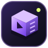

<div dir="rtl">

<div align="center">



# اثر

**مدیریت تجربه‌های فرهنگی شخصی**

یه اپلیکیشن دسکتاپ ویندوزی برای کسایی که می‌خوان کتاب بخونن، موزیک گوش بدن، فیلم ببینن و زندگیشونو برنامه‌ریزی کنن — همه‌چیز توی یه جا، بدون وابستگی به اینترنت.

---

[](https://github.com/GriefKid/asar/releases)
[](https://www.electronjs.org/)
[](LICENSE)
[](README.md)

</div>

---

## 🗂 فهرست مطالب

- [معرفی](#-معرفی)
- [امکانات](#-امکانات)
- [اسکرین‌شات‌ها](#-اسکرین‌شات‌ها)
- [نصب](#-نصب)
- [راه‌اندازی کلیدهای API](#-راه‌اندازی-کلیدهای-api)
- [میانبرهای صفحه‌کلید](#-میانبرهای-صفحه‌کلید)
- [تکنولوژی‌ها](#-تکنولوژی‌ها)
- [ساخت از سورس](#-ساخت-از-سورس)

---

## ✦ معرفی

**اثر** یه اپ کاملاً شخصی برای مدیریت تجربه‌های فرهنگیه. اگه دفترچه‌ای داری که توش مینویسی کدوم کتاب‌ها خوندی، کدوم فیلم‌ها دیدی، کدوم آهنگ‌ها گوش دادی — اثر همونه، ولی دیجیتال، با پخش‌کننده داخلی، ترجمه، هایلایت، زیرنویس، برنامه‌ریزی روزانه شمسی، و امتیازدهی روزانه.

همه داده‌ها **روی دستگاه خودت** ذخیره میشه. بدون سرور، بدون اکانت.

---

## 🎯 امکانات

### 📚 کتاب‌خوان PDF

- خواندن PDF با متن‌خوانی روان
- **هایلایت متن** با رنگ‌های مختلف (زرد / سبز / آبی / قرمز)
- **رسم مستطیل** روی هر قسمت از صفحه + رنگ‌آمیزی و یادداشت (کلید `R` یا دکمه نوار ابزار)
- **کامنت** روی هر بخش
- **ترجمه** یک صفحه یا کل کتاب به فارسی (با AI)
- **Text-to-Speech** — کتاب برات بخونه
- **حالت نمایش دو صفحه** (dual page)
- **جستجو** در متن کتاب (`Ctrl+F`)
- **بوکمارک** صفحات
- **نقد** متصل به کتاب در ویرایشگر داخلی
- **پیشنهاد موزیک** برای همزمان خوندن
- **جلد خودکار** از Google Books / Open Library — اگه پیدا نشد، جلد گرادیانت منحصربه‌فرد از روی اسم کتاب می‌سازه
- **درگ اندراپ** و **حذف** کتاب از کتابخانه

---

### 🎵 پلیر موزیک

- پخش فایل‌های صوتی از هر مسیری
- **کالکشن‌ها** — آهنگ‌ها رو دسته‌بندی کن
- **درگ اندراپ** بین کالکشن‌ها و ترتیب‌بندی مجدد
- **متن آهنگ (Lyrics)** — جستجوی خودکار از LRCLib + fallback از AI
- **ترجمه‌ی متن** به فارسی
- **اطلاعات هنرمند** با AI
- **کاور آلبوم** از Deezer CDN
- **یوتیلایزر** (visualizer) صوتی
- **اکولایزر** داخلی
- **آمار** پخش: تعداد دفعات، زمان گوش دادن
- اگه کاور نداشت — جلد گرادیانت منحصربه‌فرد می‌سازه

---

### 🎬 پلیر ویدیو

- پخش ویدیو با رابط کامل
- **زیرنویس** — جستجوی خودکار از Subdl (فارسی + انگلیسی)
- **ترجمه‌ی زیرنویس** به فارسی با AI
- **پوستر فیلم** از TMDB + fallback از Deezer
- **کالکشن‌ها** با درگ اندراپ
- **A-B Repeat** — تکرار یه بخش مشخص
- **سرعت پخش** تنظیم‌پذیر
- اگه پوستر نداشت — جلد گرادیانت منحصربه‌فرد می‌سازه

---

### 📅 برنامه‌ریز شمسی

- تقویم **شمسی (جلالی)** کامل
- **رویداد** با ساعت، رنگ، نوع (تسک / یادداشت / عادت)
- **رویدادهای تکرارشونده** (روزانه / هفتگی / ماهانه)
- **عادت‌های روزانه** — تیک بزن که انجام دادی
- **اهداف** با پیشرفت قابل ردیابی
- **تایمر پومودورو** داخلی
- **نمای امروز** روی صفحه اصلی

---

### 🏠 صفحه اصلی (داشبورد)

- **نمره عملکرد روزانه** (۰ تا ۱۰۰) بر اساس:
  - پایبندی به برنامه‌ریزی (۵۰ امتیاز)
  - انجام عادت‌های روزانه (۳۰ امتیاز)
  - بونوس تکمیل (۲۰ امتیاز)
- **نمودار ۷ روز گذشته** با مقایسه‌ی دیروز (↑/↓)
- **Heatmap فعالیت** ۳۶۵ روز گذشته
- **سطح XP** بر اساس تعداد آثار تموم‌شده
- **خلاصه‌ی هفتگی با AI** (Claude)
- آیتم‌های در حال بررسی

---

### 📖 ویرایشگر (Writer)

- نوشتن **نقد کتاب** متصل به کتاب اصلی
- سند‌های متنی آزاد
- ذخیره خودکار

---

### 📦 کتابخانه مرکزی

- همه‌ی کتاب‌ها، فیلم‌ها، موزیک‌ها در یه جا
- **سه ستون**: می‌خوام بخونم/ببینم/بشنوم · در حال · تموم شد
- **نمای قفسه** (shelf) یا **کانبان**
- **امتیازدهی** ستاره‌ای
- **نقد/review** برای هر اثر
- **درگ اندراپ** برای جابجایی بین ستون‌ها
- همگام‌سازی خودکار با همه‌ی پلیرها

---

## 📸 اسکرین‌شات‌ها

> *(اسکرین‌شات‌ها رو بعد از نصب می‌تونی اضافه کنی)*

| صفحه اصلی | کتاب‌خوان | پلیر موزیک |
|:---------:|:---------:|:----------:|
|  |  |  |

| پلیر ویدیو | برنامه‌ریز | کتابخانه |
|:----------:|:---------:|:--------:|
|  |  |  |

---

## 🚀 نصب

### دانلود نصب‌کننده (آسون‌ترین روش)

از بخش [Releases](https://github.com/GriefKid/asar/releases) آخرین نسخه‌ی `asar-setup.exe` رو دانلود و نصب کن.

نیازی به هیچ نرم‌افزار اضافه‌ای نیست.

---

## 🔑 راه‌اندازی کلیدهای API

بعضی از امکانات به کلید API نیاز دارن. همه از داخل اپ قابل تنظیمه (پنل AI در هر بخش):

| امکان | API مورد نیاز | رایگان؟ |
|:------|:-------------|:-------:|
| ترجمه، متن آهنگ، اطلاعات هنرمند، خلاصه هفتگی | Claude / Gemini / OpenRouter | ✅ (با محدودیت) |
| پوستر فیلم | TMDB | ✅ |
| زیرنویس خودکار | Subdl | ✅ |

> **نکته:** بدون API key هم می‌تونی از همه‌ی امکانات پایه استفاده کنی. AI فقط برای ترجمه و تحلیل لازمه.

### دریافت کلیدها

- **Claude AI:** [console.anthropic.com](https://console.anthropic.com)
- **Gemini AI:** [aistudio.google.com](https://aistudio.google.com)
- **OpenRouter (رایگان):** [openrouter.ai](https://openrouter.ai)
- **TMDB:** [themoviedb.org/settings/api](https://www.themoviedb.org/settings/api)
- **Subdl:** [subdl.com](https://subdl.com)

---

## ⌨️ میانبرهای صفحه‌کلید

### کتاب‌خوان

| کلید | عملکرد |
|:-----|:-------|
| `→` / `←` | صفحه قبل / بعد |
| `R` | روشن/خاموش کردن حالت رسم مستطیل |
| `Ctrl+F` | جستجو در متن |
| `Esc` | بستن / خروج |
| راست‌کلیک + درگ | رسم مستطیل (همیشه فعال) |

### عمومی

| کلید | عملکرد |
|:-----|:-------|
| `Space` | پخش / مکث (در پلیرها) |
| `Esc` | بستن پنجره |

---

## 🛠 تکنولوژی‌ها

| لایه | ابزار |
|:-----|:------|
| پلتفرم | [Electron](https://electronjs.org) 28 |
| رندر PDF | [PDF.js](https://mozilla.github.io/pdf.js/) 3.11 |
| تقویم شمسی | الگوریتم تبدیل جلالی داخلی |
| صدا | Web Audio API + Equalizer |
| AI | Claude / Gemini / OpenRouter (قابل تنظیم) |
| داده | `localStorage` (بدون دیتابیس خارجی) |
| جلدها | Google Books API + Open Library + گرادیانت Canvas |
| زیرنویس | Subdl API + ترجمه AI |
| پوستر فیلم | TMDB API + Deezer CDN |

---

## 🏗 ساخت از سورس

```bash
# کلون کردن
git clone https://github.com/GriefKid/asar.git
cd asar

# نصب وابستگی‌ها
npm install

# اجرا در حالت توسعه
npm start

# ساخت نصب‌کننده ویندوز
npm run build
```

> **پیش‌نیاز:** [Node.js](https://nodejs.org) 18+ و [Git](https://git-scm.com)

خروجی نصب‌کننده در مسیر `G:\dist\asar-setup.exe` ساخته میشه.
برای تغییر مسیر خروجی، فیلد `directories.output` در `package.json` رو ویرایش کن.

---

## 📁 ساختار پروژه

```
asar/
├── main.js              ← فرآیند اصلی Electron (IPC، API calls)
├── preload.js           ← bridge امن بین renderer و main
├── src/
│   ├── main-app/        ← داشبورد، کتابخانه، برنامه‌ریز
│   ├── apps/
│   │   ├── book-reader/ ← کتاب‌خوان PDF
│   │   ├── music-player/← پلیر موزیک
│   │   ├── video-player/← پلیر ویدیو
│   │   └── writer/      ← ویرایشگر متن
└── assets/              ← آیکون و تصاویر
```

---

## 💾 داده‌ها کجا ذخیره میشن؟

همه‌ی داده‌ها در `localStorage` مرورگر Electron ذخیره میشن — یعنی روی دستگاه خودت، بدون هیچ سروری:

| کلید | محتوا |
|:-----|:------|
| `asar-library` | کتابخانه مرکزی |
| `asar-events` | رویدادهای تقویم |
| `asar-habits` | عادت‌های روزانه |
| `asar-goals` | اهداف |
| `book-reader` | کتاب‌ها، هایلایت‌ها، یادداشت‌ها |
| `music-player` | کالکشن‌ها و آهنگ‌ها |
| `video-player` | کالکشن‌ها و فیلم‌ها |

> **پشتیبان‌گیری:** از داخل تنظیمات می‌تونی همه‌ی داده‌هاتو export/import کنی.

---

<div align="center">

ساخته‌شده با ♥ توسط [GriefKid](https://github.com/GriefKid)

</div>

</div>
